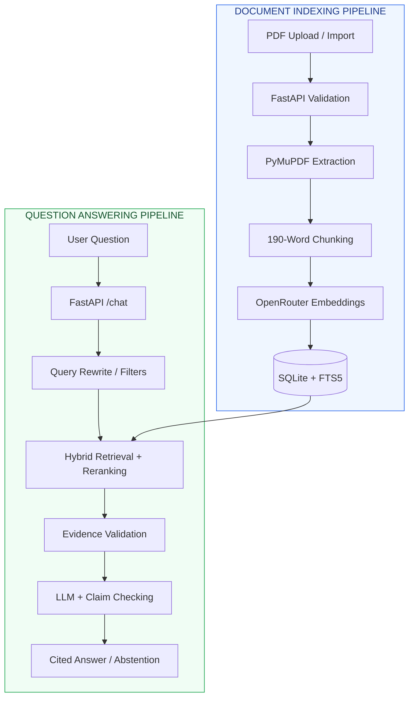
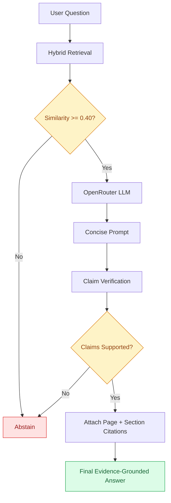

# Medical RAG — Clinical Guideline Assistant

## Overview

Medical RAG is an AI-powered clinical guideline question-answering system built using **Retrieval-Augmented Generation (RAG)**.

It retrieves relevant information from indexed clinical guideline documents and generates concise, evidence-grounded responses using Large Language Models (LLMs).

The system focuses on **answer accuracy, hallucination reduction, source traceability, and evidence verification**.

## Key Features

- **Document Indexing:** Upload and process clinical guideline PDFs.
- **Intelligent Chunking:** Split documents into overlapping 190-word chunks.
- **Hybrid Retrieval:** Combine semantic similarity, SQLite FTS5, and reranking.
- **LLM Integration:** Generate answers through OpenRouter.
- **Prompt Engineering:** Produce concise and context-aware responses.
- **Evidence Validation:** Apply a 0.40 similarity threshold.
- **Claim Verification:** Check generated claims against retrieved evidence.
- **Source Citations:** Include document page numbers and section references.
- **Hallucination Reduction:** Abstain when evidence is insufficient.
- **Streaming Responses:** Support real-time answer streaming using SSE.

## System Architecture

The system consists of two connected pipelines: document indexing and question answering.

## Answer Verification Workflow

To improve reliability, the system validates retrieved evidence before producing a final response.

## Technology Stack

| Component | Technology |
|-----------|------------|
| Programming Language | Python 3.11 |
| Backend | FastAPI, Uvicorn |
| LLM Provider | OpenRouter |
| Chat Model | GPT-4o Mini |
| Embedding Model | text-embedding-3-small |
| Database | SQLite |
| Full-Text Search | SQLite FTS5 |
| PDF Processing | PyMuPDF |
| Similarity Search | NumPy, Cosine Similarity |
| Data Validation | Pydantic |
| API Communication | HTTPX |
| Frontend | HTML, CSS, JavaScript |
| Response Streaming | Server-Sent Events |
| Testing | Pytest |

## Core AI Techniques

### 1. Retrieval-Augmented Generation (RAG)
Combines document retrieval and LLM-based generation to answer questions using relevant clinical guideline content.

### 2. Hybrid Search
Uses semantic vector similarity and keyword-based full-text search to retrieve relevant information.

### 3. Reranking
Reorders retrieved passages to prioritize the most relevant evidence.

### 4. Prompt Engineering
Uses optimized system prompts to generate clear, concise, and relevant responses.

### 5. Hallucination Prevention
Applies similarity gating, claim checking, and an abstention mechanism to reduce unsupported answers.

### 6. Citation-Aware Generation
Attaches document page numbers and section references to improve answer traceability.

## Project Objectives

- Develop an evidence-grounded medical question-answering system.
- Improve clinical document retrieval using hybrid search.
- Minimize unsupported LLM-generated information.
- Improve response clarity through prompt optimization.
- Provide transparent and traceable source citations.

## Medical Disclaimer

This project is intended for educational and research purposes.

It is not a substitute for professional medical advice, diagnosis, or treatment. All AI-generated information should be reviewed by qualified healthcare professionals before clinical use.

---

**Medical RAG — Building reliable AI systems through retrieval, verification, and evidence-grounded generation.**
